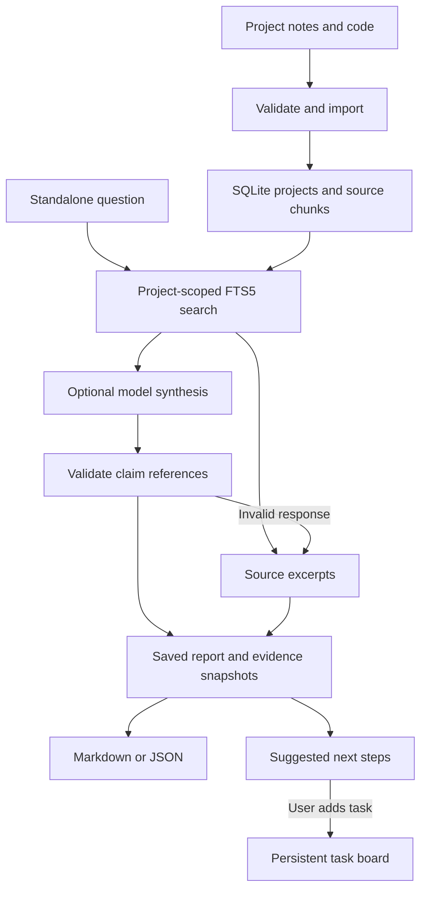

# V3 architecture

The product is a local project workspace, implemented in Python's standard library with static HTML/CSS/JavaScript. Its stages are ordinary, inspectable functions; they are not a team of autonomous agents or separately trained models.

## Modules

| Module | Responsibility |
| --- | --- |
| `store.py` | Transactions, project separation, document hashes, line-preserving chunks, BM25 retrieval, saved reports and tasks |
| `providers.py` | Fixed local Ollama/cloud OpenRouter destinations, bounded HTTP/JSON handling, server-side credentials |
| `engine.py` | Excerpts or structured synthesis, source-ID validation, TODO suggestions, visible fallbacks, Markdown exports |
| `server.py` | Loopback HTTP API, input limits, Host/Origin/session checks, static assets |
| `cli.py` | Local server, project creation, bounded folder imports, terminal questions/reports |
| `static/` | Import, ask, evidence inspection, tasks, history, export UI |

The model receives only the question and retrieved passages. It cannot run commands, read arbitrary paths, publish content, or mutate task statuses. Database writes are performed by explicit application endpoints. The task board is a human workflow, not proof that any described real-world work happened.

## Storage and retrieval

Documents are unique by project and filename. Content hashes detect unchanged imports. Reindexing removes old chunks and inserts replacements in one transaction, with FTS entries updated by triggers. Search tokenizes the query, quotes individual terms to avoid interpreting FTS syntax, and uses OR matching with BM25 ranking. Overlapping passages are deduplicated before at most six are selected.

Saved reports retain the original selected text and document digest. Live sources can change independently. Removing source content from history requires clearing reports as well as deleting the source; external backups remain outside the app's control.

The database schema is version 1. There is no automatic migration from the legacy JSON examples; import the notes you want to use. The legacy example modules remain separate, documented learning examples and are not on the V3 request path.

## Future work justified by observed use

Prioritize real model evaluation and usability checks, then address repeatedly observed retrieval failures. PDF parsing or embeddings should be added only with format-specific tests and useful examples. A public deployment would require a different server/authentication design; the loopback app should remain local.
